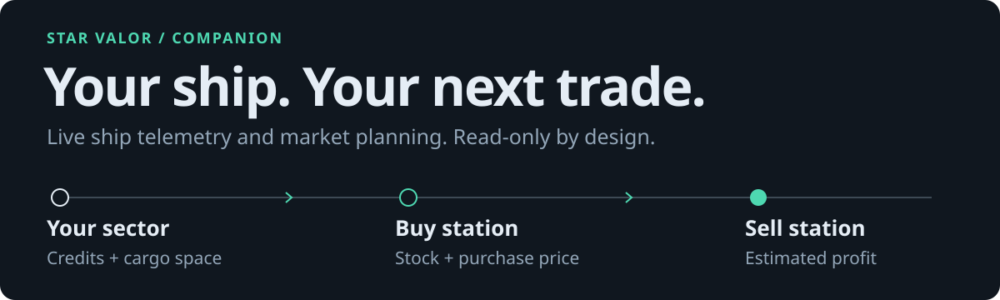
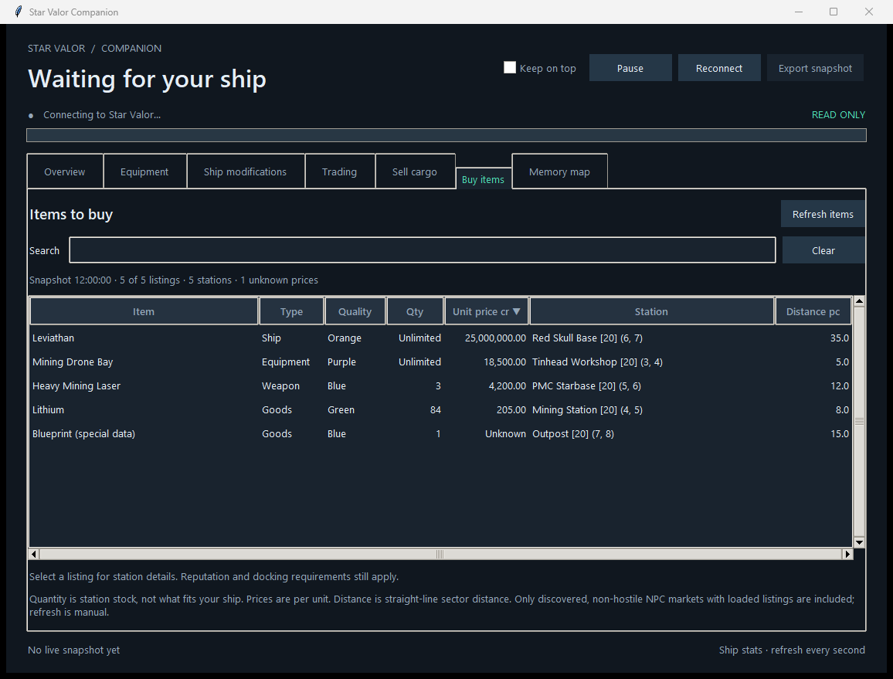

# Star Valor Companion

<p align="center">
  
</p>

A native Windows dashboard for **live ship stats, nearby trade routes, and market
prices** in Star Valor. Built with Python and Tkinter; no pip packages required.
It reads the running game so you can plan purchases and cargo sales.
**Every game interaction is read-only.**

[Quick start](#quick-start) · [Explore the dashboard](#explore-the-dashboard) ·
[Market planning](#market-planning) · [Reading model](#reading-model) ·
[Diagnostics](#diagnostics)

<p align="center">
  
</p>

*Buy items tab with sample listings from a UI verification run. These are example
prices, not live market quotes.*

## Quick start

**Requires Windows and 64-bit Python 3.11 or newer, with Tkinter** (included in the
normal Windows Python installer).

1. Download or clone this repository.
2. Start Star Valor and load your save.
3. Double-click **Launch.cmd**, or run this from the repository folder:

   ```powershell
   python app.py
   ```

The first connection can take roughly a minute while the app discovers Mono player
metadata. The window shows progress and stays responsive. Later connections in
the same game session use a validated cache; scene and ship changes follow the
active player again.

Ship stats refresh every second. **Trading**, **Sell cargo**, and **Buy items**
refresh only when you click their refresh buttons.

## Explore the dashboard

| Tab | What you can inspect |
| --- | --- |
| **Overview** | Hull, shields, energy, cargo capacity, mining and drone bonuses, power, movement, and crew efficiencies. |
| **Equipment** | Installed parts, quality, quantity, space per unit, and tech level. |
| **Ship modifications** | Active slots, tiers, and effects. |
| **Trading** | What to buy, how much, where to sell, estimated profit, and route distance. |
| **Sell cargo** | Single-station sale plans for all fleet cargo and the shared resource stash. |
| **Buy items** | Searchable purchase offers for goods, equipment, weapons, and ships. |
| **Personnel** | Available academy recruits, skills, hiring cost, requirements, station and distance. |
| **Exploration** | Faction territory map, known-sector checklist, and progress bars for visited, fully explored and fog cleared. |
| **Memory map** | Field offsets, current addresses, types, and values. |

**Pause** stops periodic reads. **Reconnect** forces fresh discovery.
**Export snapshot** saves the displayed sample, including its timestamp, as JSON.

## Market planning

Markets include discovered, intact NPC stations with non-hostile faction standing.
Prices and quantities are snapshot estimates and may change before arrival.
Distances use straight-line sector measurements; they are not jumpgate routes,
and profit estimates exclude travel costs. Player-owned stations are excluded.

### Find a trade route

Open **Trading** → **Refresh routes**. Each route pairs a buying station with a
selling station and accounts for live stock, buying limits, current credits,
free cargo space, Cargo Optimization, and item-specific cargo reservations.

- **Nearest first:** total distance from your current sector to the buying
  sector, then the selling sector. Same-sector routes use local station distances
  to break ties, using the game's latest synchronized player position.
- **Minimum profit:** defaults to 1,000 credits. Set it to zero to include every
  positive-margin opportunity.
- **Results:** up to the nearest 5,000 candidates are retained; 100 matching
  routes are displayed. A separate worker reads markets to keep ship stats responsive.

<details>
<summary>How trade prices are calculated</summary>

A station's buy-only and sell-only prices use its current stock and the installed
game's price formula. Two-way markets use the live sector trading price. Markets
whose sector price is not loaded are omitted and counted in the tab.

Player-owned stations are excluded so moving credits within your own holdings
is not presented as profit.

</details>

### Plan a cargo sale

Open **Sell cargo** → **Refresh cargo & prices**. The **Active**, **Fleet**, and
**Stash** columns show your active ship's loaded cargo, cargo on other fleet ships,
and the shared resource stash. Each plan visits one station and sells all
selected items that station buys, ranked by total proceeds, then distance.

Click an item's checkbox, or select it and press **Space**, to exclude it.
Exclusions protect copies of that item and quality across all fleet ships and the stash,
persist across restarts, and remain visible at zero quantity. Check it again
to include it.

Enable **Allow discarding items this station does not buy** to consider stations
that cannot buy the entire selection. The detail panel lists every sale and
required discard; excluded items are always kept. **The app only shows a plan:
it never sells, destroys, or moves items.**

The discard checkbox is saved immediately in `.local/sale-settings.json` and
restored on startup.

<details>
<summary>Sale valuation and REVIEW items</summary>

All living ships in the player's fleet roster are included, even when docked,
in a hangar, or in another sector. Duplicate ship/hold references are counted
once, and the shared resource stash is taken only from the active ship. Station
storage and crew are excluded. The plan's source breakdown identifies each
ship contributing an item. Bring remote fleet cargo to the chosen station;
the plan does not calculate retrieval routes or apply fleet docking restrictions.

Stash resources are included directly, without applying ship cargo capacity.
Goods use current station quotes. Equipment and weapons include rarity, resale
skills, and the ship trade modifier. Packaged ships include their model, traits,
equipment, and contents where readable.

Special-data items and unknown prices are marked **REVIEW**, never discard.
Incomplete quotes rank after complete plans, and totals show only known proceeds.
Exclude review items for a complete comparison. Estimates exclude travel costs;
refreshes are manual.

</details>

### Find an item to buy

Open **Buy items** → **Refresh items**. Each offer shows item, quality, available
station quantity, unit price, station/sector, and distance from your position at
refresh. Unlimited stock is labeled explicitly. **Quantity is station stock,
not what your current credits or cargo capacity allow.**

Search by item name, type, quality, station, faction, ID, or sector coordinates.
Multiple words must all match. Click column headings to sort by price, distance,
or another field. Search and sorting use the current snapshot without refreshing
game memory.

<details>
<summary>Purchase prices and market visibility</summary>

Equipment, weapon, and ship prices include reputation rank, purchase skill, and
ship trade modifiers. Reputation and docking requirements still apply.
Special item data and unavailable quotes remain listed with **Unknown** prices.

Only markets whose listings are loaded in memory can appear. Unexplored stations
and markets without loaded listings cannot be listed. Quotes and quantities may
change before arrival.

</details>

### Find personnel to hire

Open **Personnel** and click **Refresh personnel**. Search crew names, skills
(such as Engineer or Pilot), quality, stations or factions. Click the name,
level, hiring cost, requirement or distance heading to sort. Select a recruit
for the full name, skill ranks and bonus-level counts. Refresh is manual.

The page reads recruitment IDs from discovered, non-hostile NPC academies,
including stations without an item market. It does not generate missing
recruits or perform hiring. Ungenerated rosters are counted; unresolved crew
records retain an Unknown quote. Hiring cost includes the recruitment skill
discount. The requirement is minimum Space Pilot OR Fleet Commander; credit,
berth and docking restrictions still apply. Prices are current estimates.

### Track exploration

Open **Exploration** and click **Refresh exploration** for three distinct progress
bars: visited sectors, fully explored sectors, and fog cleared across measured
visited sectors. Known, unvisited and unfinished counts remain in the summary
line instead of complementary progress bars.
Counts and percentages use all sectors currently recorded in the save, rather
than an assumed fixed galaxy size. The status line also reports uncharted sectors
and visited sectors whose fog data is unknown.

The territory map colours each known sector by the game's current faction
control, including Independent and Unclaimed, with a colour/count legend.
White borders mark fully explored sectors; a white ring marks your current
sector. Drag to pan, use the mouse wheel or +/− to zoom, and click Fit to see
all known sectors. Click a cell to select its row, or select a row to highlight
the cell. Each cell represents one sector; the map does not infer borders across
unknown space. Search also matches faction names. Old snapshots without faction
data use dark-grey Unknown ownership.

Visited means the game's `discovered` flag. Fully explored means visited and
generated, with an existing fog list containing zero remaining tiles. Percent
explored uses the game's `(fowXtiles + 1) * (fowYtiles + 1)` total. Missing or
inconsistent fog data stays Unknown. The fog bar is weighted by tile count and
excludes unknown measurements. Known-sector rows can be searched and filtered by
visited/completed state, with exploration percentage and distance. Uncharted
names and coordinates are hidden. Refresh is manual and read-only.

## Reading model

The app requests only `PROCESS_QUERY_INFORMATION | PROCESS_VM_READ`. It does not
request write, remote-thread, or VM-operation access, inject code, call game
functions, or change saves.

Memory can change during a read. Each sample revalidates the active player and
retries during loading. If disconnected, the last values stay visible with their
snapshot timestamp and a disconnected status.

**Compatibility:** the name catalog comes from Star Valor **2.2.5a, Steam build
25793649**. Unknown equipment and modifications remain visible by ID. Future game
updates may require a refreshed catalog or reader changes.

<details>
<summary>Telemetry sources and interpretation</summary>

Discovery reads private committed regions and follows Mono class metadata to
`PlayerControl.inst`. The selected player and ship must have live Unity native
handles and the ship's `isPlayerCharacter` flag.

- Current hull and reactor heat come from `SpaceShip`.
- Calculated bonuses come from `ShipStats`; cargo capacity comes from `CargoSystem`.
- Shield capacity includes the live shield power setting and engineer modifier.
- Energy generation and passive draw are raw stats, not net energy. Some action
  costs are excluded.
- Cargo shown on Overview is capacity, not used cargo.

Addresses change across sessions; field offsets come from the running Mono
metadata. A future change to Mono's native metadata layout may require a reader
update.

</details>

## Diagnostics

Read one live snapshot to JSON:

```powershell
python app.py --probe --output snapshot.json
```

Force fresh metadata discovery:

```powershell
python app.py --probe --fresh --output snapshot.json
```

Run the test suite:

```powershell
python -m unittest discover -s tests -v
```

If the game runs as administrator, Windows may require launching the app at the
same privilege level. Normal launches do not request administrator access.

<details>
<summary>Local settings, cache, and logs</summary>

All local state lives in `.local/` beside the app:

| File or data | Purpose |
| --- | --- |
| `window.json` | Window position, size, and maximized state, saved on quit. |
| `sale-exclusions.json` | Item and quality exclusions, saved immediately. |
| Connection cache | Validated metadata for faster reconnection. |
| `companion.log` | Rotating diagnostic logs. |

Window bounds are restored on startup. If a monitor was disconnected, the saved
bounds move into the nearest available monitor's work area.

</details>

## CLI and agent skill

Run `Companion.cmd` or `python cli.py` from this folder. Commands return JSON to
stdout, send discovery progress to stderr, and exit after one read. No extra
packages are required. The CLI shares the GUI's readers and calculations.

```powershell
.\Companion.cmd ship
.\Companion.cmd ship --section equipment --search drone
.\Companion.cmd trades --min-profit 1000 --limit 10
.\Companion.cmd inventory
.\Companion.cmd sell --allow-discard --limit 5
.\Companion.cmd buy --search "mining drone" --sort price
```

| Command | Function |
| --- | --- |
| `ship --section summary` | Overview ship values; the default section. |
| `ship --section equipment` | Installed parts, with optional `--search`. |
| `ship --section modifications` | Ship modifications and effects. |
| `ship --section crew` | Crew efficiencies. |
| `ship --section memory` | Live memory map, with optional `--search`. |
| `ship --section all` | Complete ship snapshot for export. |
| `trades` | Nearest arbitrage routes; supports profit threshold, search and limit. |
| `inventory` | All fleet cargo, resource stash, item sources, keys and saved exclusions. |
| `sell` | Single-station sale plans, including SELL, DISCARD and REVIEW entries. |
| `buy` | Purchase listings; search and sort by price, quantity, distance, item or station. |
| `personnel` | Academy recruits; search and sort by cost, distance, level, requirement or name. |
| `exploration` | Exploration totals and sector progress; supports `--state incomplete` and `--search`. |
| `exclude list/add/remove` | Manage persistent item exclusions by `TYPE:ID:QUALITY`. |
| `preferences` | Read or change the persistent discard checkbox. |
| `catalog` | Search static item data without the game running. |
| `gui` | Launch the native app, optionally with `--tab Overview`, `--paused`, or `--keep-on-top`. |

Use `COMMAND --help` for details. `--limit 0` means all retained matches. Live
commands accept `--fresh` for rediscovery, `--timeout 120` for scan cancellation,
and `--output PATH` to also save their JSON result. Results use
`{"command": "...", "data": ...}`. Unknown prices are `null`; unlimited purchase
stock is a `null` quantity. Catalog prices are base prices, not station quotes.

For offline comparisons, export the matching reader's complete data with `--raw`:

```powershell
.\Companion.cmd sell --raw --output sale-snapshot.json
.\Companion.cmd sell --input sale-snapshot.json --no-allow-discard
.\Companion.cmd sell --input sale-snapshot.json --allow-discard --exclude 3:23:1
```

Sale overrides apply to that command only. To save a preference, use
`preferences --allow-discard` or `preferences --no-allow-discard`. To save an item
exclusion, use `exclude add 3:23:1 --name "Drone Parts"`; remove it with
`exclude remove 3:23:1`. Repeated add/remove calls are idempotent. An already-open
GUI loads CLI preference changes when reopened. Local files are shared; use one
writer at a time when changing the same preference from the GUI and CLI.

Live reads require a loaded save. Errors leave stdout empty and emit JSON on
stderr: exit 1 for invalid snapshots/I/O, 2 for unavailable memory, 124 for
cancelled/timed-out reads, and 130 for interruption. Argument usage errors also
exit 2 and print argparse help. Pause/resume and existing-window controls remain
in the GUI; CLI reads naturally stop when complete.

The agent skill is [skills/star-valor-companion/SKILL.md](skills/star-valor-companion/SKILL.md).
It is also installed for this computer's Codex agents as `$star-valor-companion`.
For another checkout, update its documented CLI path and copy its folder into
your agent's skill directory. Like the GUI, the CLI only plans transactions;
it never buys, sells, destroys cargo, or writes game memory.

## License

[GNU General Public License v3](./LICENSE).
